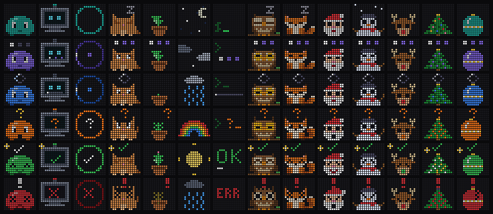

# Evo bridge

Turns a Divoom Timebox Evo (16×16 LED speaker) into a status light for Claude Code. A small pet on the display shows whether Claude is thinking, working, waiting for you, done, or hit an error.

```
Claude Code hooks ──curl──▶ computer bridge (http://127.0.0.1:8787) ──Bluetooth──▶ Timebox Evo
```

There are two ways to run the bridge, with the same HTTP API and the same art:

- **Computer bridge** (current setup, no extra hardware): a small Node program on the computer running Claude Code talks to the Evo over its own Bluetooth. See [Computer bridge](#computer-bridge).
- **ESP32 bridge:** a board on Wi-Fi (`http://evo.local`) holds the Bluetooth link, so the Evo works for any computer on the network. See steps 1–2 below, and set `EVO_URL=http://evo.local` for the hook.

| State | Looks like | Sent when |
|---|---|---|
| `idle` | teal blob, blinking | session started; 30 s after `done` |
| `thinking` | violet, three dots | you submit a prompt |
| `working_bash` | blue, `>_` prompt | Bash tool |
| `working_edit` | blue, pencil | Edit / Write |
| `working_read` | blue, open book | Read / Grep / Glob / Web* |
| `working` | blue, spinner | any other tool |
| `needs_input` | orange, `?` | permission prompt, a question for you, plan approval |
| `done` | green, check mark | Claude finishes its turn |
| `error` | red, `!`, shaking | a tool call failed |
| `clock` | the Evo's own clock | everything idle for 2 minutes |

The computer bridge sets the Evo's clock from the computer's time every time it connects and once an hour after that.

With several Claude Code sessions, the display shows the most urgent one (needs_input > error > working > thinking > done > idle). It only goes idle once every session has finished.

### Unread markers

Computer bridge only: each session that waits for you gets one pixel along the top of the display, from the left, oldest session first. Orange means it needs your input, red that it hit an error, and green that it finished. A green marker stays after the pet has gone back to idle, until you send that session a new prompt, close it, or choose **Clear markers** in the companion app (or its tray menu), so you can see at a glance how many sessions finished while you were away. While there are markers the idle pet stays instead of the clock, because the Evo's own clock can't carry them. Switch them off on the companion app's Display tab, or with `"unreadMarkers": false` in `config.json`.

## Characters

Fourteen characters (art sets), all with the same states; the last five are for Christmas. Pick one from the grid on the companion app's Display tab, or set `"theme"` in `config.json`; the computer bridge switches at once.



| Character (`theme`) | Idea |
|---|---|
| `blip` (default) | The original pet: a round blob whose colour shows the state. |
| `robot` | A robot head: the antenna light shows the state, the screen shows the work. |
| `ring` | A coloured ring with one symbol: the easiest to read from across the room. |
| `critter` | A small loaf creature: naps when idle, types while working, stares when it needs you. |
| `sprout` | A potted plant: sways when idle, grows while working, droops when it needs you, blooms when done. |
| `weather` | A little sky: stars when idle, rain while working, a rainbow when it needs you, sun when done. |
| `terminal` | Plain text: a blinking cursor, a progress bar, `?`, `OK` and `ERR`. |
| `owl` | An owl on a branch: sleeps when idle, watches its talons while working, stares wide-eyed when it needs you, flaps its wings when done. |
| `fox` | A sitting fox: sleeps when idle, swishes its tail while working, pricks up its ears when it needs you, wags its tail when done. |
| `santa` | Santa's face: the pompom on his hat swings, he calls out when he needs you and smiles when done. |
| `snowman` | A snowman in falling snow: waves his stick arms when he needs you, throws them up when done. |
| `reindeer` | A reindeer with a glowing red nose: it flashes orange when it needs you and turns green when done. |
| `tree` | A Christmas tree whose lights show the state: blue while working, orange when it needs you, all lit when done. |
| `bauble` | A Christmas ball whose colour shows the state: it swings gently when idle and cracks on an error. |

The characters are code in `tools/art/themes/`. After changing or adding one, run `npm run art` in `tools/` to re-render the GIFs, plus a preview sheet per character (one row per state) in `tools/art/preview/` (`sheet.png` is Blip; not committed). Run `npm run characters` to redraw the picture above.

## Layout

```
firmware/   PlatformIO project for the ESP32 bridge
  include/states.h        generated animation bytes (committed)
  include/config.h        timings, rate limit, transport, escaping flag
  include/secrets.h       your Wi-Fi + Evo MAC (gitignored; copy the .example)
  test/host/run.sh        PC-side tests for the encoder and state machine
bridge/     computer bridge: HTTP server + Bluetooth link, no ESP32 needed
companion/  tray app for the computer bridge: status, brightness, settings, service
hooks/      evo-hook.sh + settings snippet for ~/.claude/settings.json
tools/      pixel art + the script that turns it into states.h
```

## Computer bridge

Needs Node 18+ and a Python with Bluetooth sockets. Fedora's `/usr/bin/python3` has them; Homebrew's Python doesn't, so the bridge uses `/usr/bin/python3` unless `EVO_PYTHON` says otherwise.

1. Pair the Evo with the computer in Bluetooth settings (PIN `0000` if asked). Unplug the ESP32 bridge if it is running: the Evo takes only one data connection.
2. Install the art tools once: `(cd tools && npm install)`.
3. Put a random token in `~/.config/evo-bridge/token` (for example `openssl rand -hex 16`). The hook reads the same file.
4. Run it: `node bridge/evo-bridge.js`. It finds the paired device named `TimeBox…` (or set `EVO_MAC`), listens on `127.0.0.1:8787` (`EVO_PORT`), and reconnects by itself if the Evo goes away.
5. To start it automatically at login, install the systemd user service; see the comments in `bridge/evo-bridge.service`.

The computer bridge reads the art straight from `tools/art`, so after `npm run build` just restart it; there's nothing to flash. It accepts requests only from this computer, with the same token, `Host` and `Origin` checks as the ESP32. Its state machine (`bridge/state-machine.js`) is a port of the firmware's; `node bridge/test-state-machine.js` runs the same tests against it.

`bridge/rfcomm-pipe.py` holds the Bluetooth connection: bytes from the bridge go to the Evo, and it exits when the link drops so the bridge can reconnect.

Settings live in `~/.config/evo-bridge/config.json`: which Evo, brightness, character (`theme`), unread markers, and the timings from [Tuning](#tuning) (in ms; `idleToClockMs: 0` turns the clock off). Every field is optional. The companion app edits this file for you, and changes apply without a restart.

### Companion app

A small tray app for the computer bridge (Qt, so it looks native on KDE):

- **Status:** what the Evo shows, whether it's connected, and each Claude Code session by project folder, with the ones waiting for you marked. The tray icon takes the pet's colour, and its tooltip counts the waiting sessions.
- **Display:** brightness, the [character](#characters), the [unread markers](#unread-markers), scrolling text, preview each animation, and open the art editor.
- **Settings:** pick the Evo from your paired devices, and change the timings.
- **Service:** start, stop or restart the bridge, start it at login, and read its log.

```bash
sudo dnf install python3-pyside6   # if it's missing
companion/install.sh               # adds "Evo companion" to the app menu
```

#### Art editor

**Display → Edit the animations…** (or **Art editor…** in the tray menu) opens a 16×16 pixel editor for each state's animation:

- Pencil, fill and colour picker. Left-click paints with the chosen colour; right-click paints black, which means the LEDs are off.
- A frame list: add, duplicate, delete, clear and reorder frames, and set how long each one shows (in 10 ms steps).
- Onion skin (shows the previous frame faintly), a live preview, and undo/redo (Ctrl+Z / Ctrl+Shift+Z).
- **Try on Evo** shows your version for a few seconds without saving. **Save** writes `tools/art/custom/<state>.gif`, and the computer bridge uses it right away. **Use starter art** deletes your version.

The editor works on the current character, and saved art is an ordinary 16×16 GIF in `tools/art/custom/<theme>/`, so the ESP32 can use it too: run `npm run states -- --theme <theme>` in `tools/` and reflash.

Or run `companion/evo-companion.py` directly. Closing the window keeps it in the tray; quit from the tray menu. The Service tab can also open it in the tray at login, or make it always start minimized in the tray. `companion/install.sh --remove` takes the menu entry away.

## 1. Find the Evo's Bluetooth MAC

Disconnect the Divoom phone app first: the Evo takes only one data connection at a time.

```bash
bluetoothctl scan on
```

Look for a `TimeBox-Evo…` entry and note the address (`11:75:58:…`). Stop scanning with `scan off`. The Divoom app also shows the MAC under device info.

**Check which generation you have.** This code speaks the classic Evo protocol over Bluetooth Classic SPP. The name doesn't tell you: a classic Evo also calls itself `TimeBox-Evo-audio`. What matters is whether it offers a serial port, which you can only see after pairing. Pair it once from the PC, check, then unpair:

```bash
bluetoothctl pair <MAC>
```
```bash
bluetoothctl info <MAC> | grep 00001101
```
```bash
bluetoothctl remove <MAC>
```

If the second command prints a line (Serial Port), this code applies. If not, it's the newer BLE-only generation (Anyka chip, see the `divoom-protocol` package), which speaks a different protocol.

**Pairing.** The Evo uses legacy PIN pairing with PIN `0000`. The bridge uses that by default (set `EVO_PIN` in `secrets.h` only if yours differs). After a few wrong PINs the Evo refuses every device, even ones that worked before, until you switch it off and on again.

## 2. Configure and flash the ESP32

Install PlatformIO (`pipx install platformio`), then:

```bash
cd firmware
cp include/secrets.h.example include/secrets.h   # then edit: Wi-Fi, EVO_MAC, BRIDGE_TOKEN, SETUP_AP_PASSWORD
pio run -e esp32dev -t upload
pio device monitor
```

- `BRIDGE_TOKEN` is a shared secret that every request must carry. Generate it with `openssl rand -hex 16`, put it in `secrets.h`, and save the same value for the hook:

  ```bash
  mkdir -p ~/.config/evo-bridge && (umask 077 && echo 'PASTE-TOKEN-HERE' > ~/.config/evo-bridge/token)
  ```

  The build refuses to compile while the token still has the example value.
- Use `-e firebeetle32e` for the DFRobot FireBeetle ESP32-E. The ESP32-C3 Super Mini **won't work** for this phase because it has no Bluetooth Classic.
- **Permission denied on `/dev/ttyUSB0` or `/dev/ttyACM0`:** run `sudo usermod -aG dialout $USER`, then log out and back in.
- **Upload hangs on `Connecting…`:** hold the **BOOT** button until the upload starts.
- **Upload fails with "Failed to start stub flasher" or "No more data to read from the serial port":** usually a bad USB cable or port. Use a short data cable straight into the computer, not a hub. Uploads run at 115200 baud because many NodeMCU USB chips can't keep up with faster speeds.

The serial monitor should show `[wifi] <ip>`, `[mdns] http://evo.local`, `[bt] Evo offers channel 1: Serial Port 1`, then `[bt] connected`. The Evo switches to the idle pet.

If it shows `[bt] pairing FAILED` instead:
1. Disconnect the phone app.
2. Switch the Evo off and on.
3. Press the ESP32's EN/reset button.

If the Evo still refuses, set `EVO_BT_LOCAL_MAC` in `config.h` (for example `"02:eb:0a:00:00:01"`), so the Evo sees the bridge as a new device.

Then try:

```bash
T="X-Evo-Token: $(cat ~/.config/evo-bridge/token)"
curl -H "$T" http://evo.local/state/thinking
curl -H "$T" http://evo.local/status
curl -H "$T" -X POST -H 'Content-Type: text/plain' --data 'Hello from Claude' 'http://evo.local/text?color=ffd23a'
curl -H "$T" http://evo.local/brightness/60
```

## Changing Wi-Fi (no reflash needed)

The bridge remembers the network it's on. `WIFI_SSID` in `secrets.h` is only used on first boot. If it can't join a known network, it opens a setup hotspot:

1. Join the Wi-Fi network **`evo-bridge-setup`** from your phone or laptop. The password is `SETUP_AP_PASSWORD` from `secrets.h`.
2. The setup page usually opens by itself; otherwise browse to `http://192.168.4.1`.
3. Choose **Configure WiFi**, pick your network, enter its password and save. The bridge joins it and remembers it.

If nobody completes setup within 5 minutes, the bridge reboots and tries its saved network again. A router restart sorts itself out this way.

To switch networks while the old one is still in range, open the hotspot in one of two ways:

- **Over HTTP:**
  ```bash
  curl -H "X-Evo-Token: $(cat ~/.config/evo-bridge/token)" -X POST http://evo.local/wifi/reset
  ```
  It reboots into the hotspot and keeps the saved network, in case you don't finish setup.
- **With the BOOT button:** press EN (reset), then within 3 seconds hold BOOT for a second. Don't hold BOOT *while* pressing EN, because that starts the flasher instead.

The setup page only offers Wi-Fi setup. Its firmware-upload, erase and info pages are blocked (they return 403), so the hotspot can't be used to replace the firmware.

## 3. Install the Claude Code hooks

1. Make the script executable (it already is in git): `chmod +x hooks/evo-hook.sh`.
2. Merge `hooks/settings.snippet.json` into the `hooks` section of `~/.claude/settings.json`. Replace `/ABSOLUTE/PATH/TO` with this repo's path. If you already have hooks for an event, add this entry to its list instead of replacing it.
3. Save the bridge token for the hook in `~/.config/evo-bridge/token` (see step 2), or set `EVO_TOKEN`. The hook passes it to curl on stdin, so it doesn't show up in the process list.
4. The hook talks to the computer bridge (`http://127.0.0.1:8787`) by default. For the ESP32, set `EVO_URL` to `http://evo.local` or, faster, the board's IP address (for example in your shell profile, or in the `env` section of `settings.json`): `"env": { "EVO_URL": "http://192.168.1.50" }`.

The hook sends its request in the background with a 1-second timeout. If the bridge is unplugged, Claude Code doesn't notice. Each request carries the event time (`&t=`), so the bridge ignores requests that arrive out of order, and the project folder's name (`&name=`), which the companion app shows. To see what the hook would send, run:

```bash
echo '{"hook_event_name":"PreToolUse","session_id":"t1","tool_name":"Bash"}' | EVO_HOOK_DEBUG=1 hooks/evo-hook.sh
```

| Hook event | State |
|---|---|
| `SessionStart` | idle |
| `UserPromptSubmit` | thinking |
| `PreToolUse` | working variant for the tool (`AskUserQuestion` / `ExitPlanMode` → needs_input) |
| `PostToolUse` | same working variant, or `error` if the result says `is_error` |
| `PostToolUseFailure` | error |
| `PermissionRequest` | needs_input |
| `Notification` | needs_input, except the "waiting for your input" reminder after a finished turn |
| `SubagentStop` | working (the main agent continues) |
| `Stop` | done |
| `StopFailure` | error (the turn ended with an API error) |
| `SessionEnd` | removes the session |

## HTTP API

Every endpoint except `/` requires all three of these:

- **`X-Evo-Token` header** matching `BRIDGE_TOKEN`. Otherwise the bridge returns 401.
- **`Host` header** of `evo.local`, `evo` or the bridge's IP (computer bridge: `127.0.0.1:8787` or `localhost:8787`). Otherwise it returns 403. This blocks web pages from reaching the bridge through DNS rebinding.
- **No `Origin` header.** Otherwise it returns 403. Browsers add one; curl and the hook don't.

Together, these mean a web page you visit can't drive the display, and other devices on your network need the token. The token travels in plain HTTP, so someone sniffing your Wi-Fi could still read it. That's acceptable for a display, but don't reuse the token anywhere else.

| Request | Effect |
|---|---|
| `GET /state/<state>?session_id=<id>&t=<ms>&name=<project>` | Report a session's state. `end` removes the session. `t` is optional; older events than the newest seen are dropped. `name` is optional and computer bridge only: a label for the session (the hook sends the project folder's name). |
| `POST /unread/clear` | Computer bridge only: finished sessions stop counting as [unread](#unread-markers). |
| `POST /text` | Body (or form field `text`) scrolls across the display. Optional `?color=RRGGBB`. The current state returns after a few seconds. |
| `GET /brightness/<0-100>` | Set display brightness. |
| `GET /status` | JSON: transport, connected, displayed state, active text, Wi-Fi network, sessions. |
| `GET /config`, `POST /config` | Computer bridge only: read or change the settings (JSON, see `bridge/config.js`). |
| `GET /preview/<state>` | Computer bridge only: show that state's animation for 5 seconds. |
| `GET /themes` | Computer bridge only: the themes with a preview each; switch with `POST /config {"theme": "robot"}`. |
| `GET /art`, `GET /art/<state>` | Computer bridge only (all `/art` routes take `?theme=`, default the current one): which states have custom art; a state's frames as JSON. |
| `POST /art/<state>` | Computer bridge only: save frames (`{"frames":[{"pixels":[256 × "rrggbb"],"ms":100}]}`) as `tools/art/custom/<state>.gif`. |
| `POST /art/<state>/try`, `DELETE /art/<state>` | Computer bridge only: show frames without saving; go back to the starter art. |
| `POST /wifi/reset` | ESP32 only: reboot into the Wi-Fi setup hotspot (the saved network is kept). |

## Changing the art

Starter art is defined in code: Blip in `tools/art/sprites.js`, the other themes in `tools/art/themes/`. To use your own, drop a GIF (animated) or PNG into `tools/art/custom/<theme>/<state>.gif` (or `.png`); for Blip, `tools/art/custom/<state>.gif` works too. The art editor saves there for you. 16×16 is ideal. Larger art is scaled down with nearest neighbor, and transparent pixels show as off. Any state name from the table above works except `clock`, which is the Evo's built-in clock. Then:

```bash
cd tools
npm install
npm run build      # renders every theme's GIFs and preview sheets, then writes firmware/include/states.h (Blip)
npm run states -- --theme robot   # states.h from another theme
```

Reflash afterwards. The firmware only replays the bytes generated here; all image encoding happens on the PC in `tools/evo-encode.js`. That's a small, dependency-free port of [node-divoom-timebox-evo](https://github.com/RomRider/node-divoom-timebox-evo), and `npm test` checks it byte for byte against output frozen from that library.

## Tuning

Computer bridge: use the companion app, or edit `~/.config/evo-bridge/config.json`. ESP32: everything is in `firmware/include/config.h`, and each value can be overridden with a `-D` flag in `platformio.ini`:

- `EVO_MSG_INTERVAL_MS` (60): gap between messages. The Evo drops the link above about 30 messages/s.
- `EVO_WORKING_DEBOUNCE_MS`, `EVO_MIN_DISPLAY_MS`, `EVO_ERROR_HOLD_MS`: anti-flicker timings.
- `EVO_DONE_HOLD_MS` (30 s) and `EVO_IDLE_TO_CLOCK_MS` (2 min, `0` = never show the clock).
- `EVO_STALE_BUSY_MS` (10 min): a session stuck in thinking/working this long goes idle. Interrupting Claude with Esc sends no `Stop` event.
- `EVO_ESCAPE_PAYLOAD` (0): set to 1 if your Evo firmware needs `0x01–0x03` escaped inside messages. Try this if the connection works but the display ignores everything.

## Tests

```bash
./test.sh
```

runs everything, and GitHub Actions runs the same on every push. The suites are:

```bash
firmware/test/host/run.sh
(cd tools && npm test)
node bridge/test-state-machine.js
node bridge/test-config.js
node bridge/test-markers.js
node bridge/test-art-routes.js
```

The first of these compiles the protocol encoder and state machine for the PC. It checks them against byte-for-byte output from the Node library (text, brightness, framing of every state) and covers debounce, error hold, multi-session, out-of-order events, stale sessions, timeout, and `millis()` wrap-around behavior. The second checks the PC-side encoder against the library's frozen output (all starter states, text, brightness) and tests GIF compositing and scaling.

## Phase 2: inside the case (not started)

`pio run -e uart-tap` builds the same firmware with a wired UART transport (`EVO_UART_*` pins/baud in `config.h`). It's untested: whether the LED board accepts Divoom frames on TX2/RX2 still needs sniffing. Notes:

1. Confirm the pads are 3.3 V logic.
2. Sniff TX2 (RX only, shared GND) while the app sends content. Find the baud rate and look for `0x01 … 0x02` frames.
3. Power: use the Evo's USB 5 V into the ESP32's 5V pin, or tap the battery after the power switch through a low-dropout LDO (ME6211 / RT9013 / HT7333). Never use the 3V3 test pad. The NodeMCU's AMS1117 can't run from a Li-ion cell. Unplug the battery before soldering, and keep the ESP32 antenna away from the speaker magnet.
